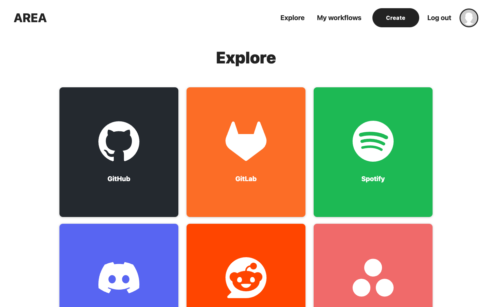
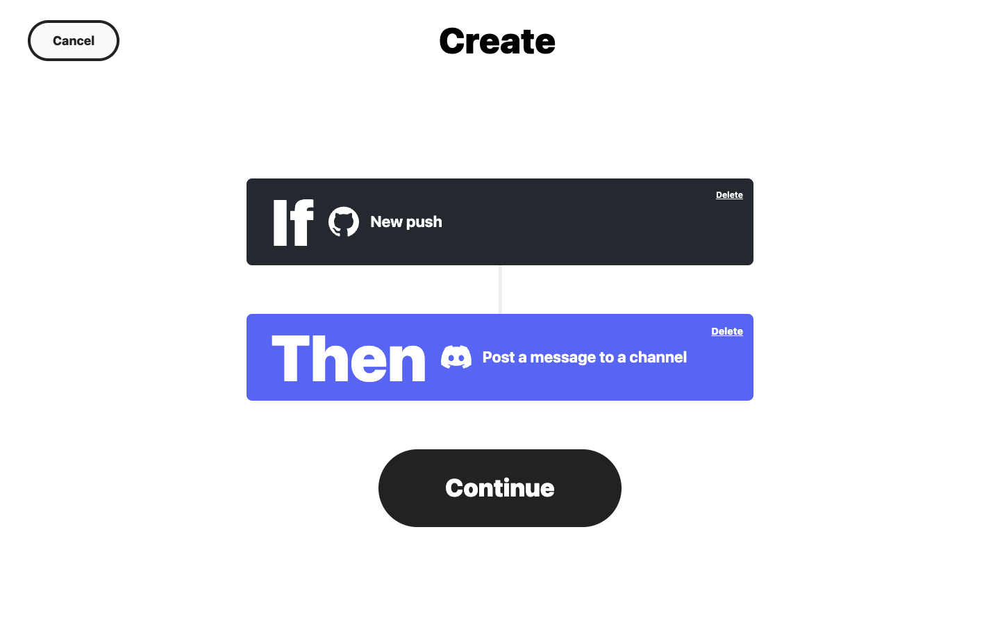
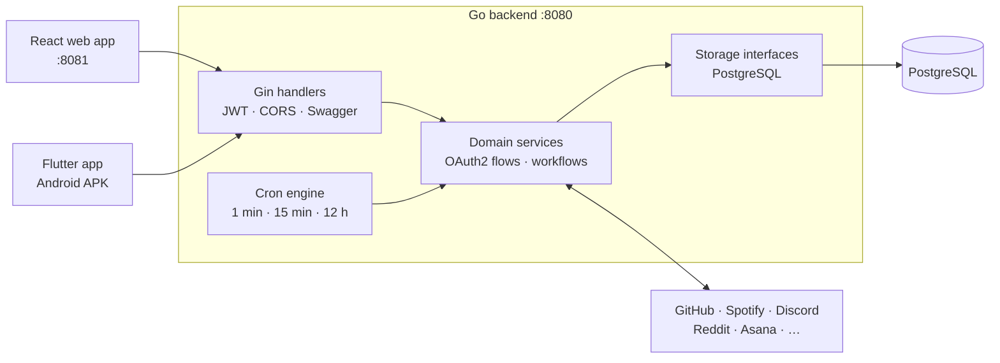

<div align="center">

# AREA: an IFTTT-style automation platform

**Connect an action on one service to a reaction on another. Go backend, React web app, Flutter mobile app, one `docker-compose up`.**

[](https://github.com/yanishk/AREA/actions/workflows/backend.yaml)
[](https://github.com/yanishk/AREA/actions/workflows/frontend.yaml)
[](https://github.com/yanishk/AREA/actions/workflows/mobile.yaml)
[](https://github.com/yanishk/AREA/actions/workflows/docker-build.yaml)


 

[Quick start](#quick-start) · [Services](#services) · [Architecture](#architecture) · [API](#api) · [Add a service](#add-a-service) · [Team](#team)

</div>

---

## About

AREA (Action REAction) is the third-year software architecture project of Epitech. The brief: build a product that lets a user chain an **action** (a new commit on GitHub, a new post in a subreddit, a time of day) to a **reaction** on another service (send a Discord message, create an Asana task, email a reminder), with a REST backend consumed by both a web client and a mobile client.

Users register with an email and password or sign in with any of the nine OAuth2 providers, link the services they want with OAuth2, then build workflows step by step. Workflows run server-side on scheduled checks, so they keep working while every client is closed.

## Highlights

- **13 services, 9 of them OAuth2**: GitHub, GitLab, Spotify, Discord, Reddit, Asana, LinkedIn, Dropbox and Google, plus built-in date and time, weather, email and SMS. Tokens are refreshed automatically when a provider supports it.
- **Three-layer Go backend**: HTTP handlers (Gin) → domain services → PostgreSQL storage behind interfaces, which lets the 200+ unit tests run against mocks (and `sqlmock` for the storage layer) with no live database.
- **Scheduled trigger engine**: cron jobs at 1 min, 15 min and 12 h poll each action type at a cadence that respects provider rate limits.
- **One REST API, two clients**: a React + TypeScript + Tailwind web app and a Flutter app share the same JWT-protected endpoints. The web container also serves the Android APK built by the mobile container.
- **Documented API**: Swagger UI at `/swagger/index.html`, generated from code annotations, and an `/about.json` endpoint listing every service, action and reaction, as required by the subject.
- **Accessible UI**: colour palette and contrasts chosen to stay readable for colour-blind and visually impaired users.
- **Engineering hygiene**: GitHub Actions for every part (backend build, unit tests and `gofmt`, frontend build, Flutter APK, Docker Compose build), SonarQube analysis, Conventional Commits with gitmoji.

## Quick start

### Prerequisites

- Docker and Docker Compose
- A PostgreSQL database (local or hosted) and the OAuth2 client IDs of the services you want to enable. Copy `backend/.env.example` to `backend/.env` and fill it in; a service with no credentials is simply not offered to users.
- Copy `mobile/.env.example` to `mobile/.env` as well: the mobile image copies it at build time and fails without it.

### Run

```bash
git clone https://github.com/yanishk/AREA.git
cd AREA
docker-compose build
docker-compose up
```

| Component | URL |
|-----------|-----|
| Web client | http://localhost:8081 |
| REST API | http://localhost:8080 |
| Swagger UI | http://localhost:8080/swagger/index.html |
| Android APK | http://localhost:8081/area.apk |
| Services manifest | http://localhost:8080/about.json |

> [!NOTE]
> Ports 8080 and 8081 must be free. OAuth2 callbacks need a public URL; the project uses ngrok in development (`NGROK_APP_URL`).

## Services

| Service | Auth | Actions (triggers) | Reactions |
|---------|------|--------------------|-----------|
| GitHub | OAuth2 | new push, branch, repository, issue assigned, pull request (polling); star, release, fork, wiki, milestone, visibility change, workflow run or job (webhooks) | |
| GitLab | OAuth2 | push, tag push, merge request, issue, comment, wiki page, release, pipeline, job, deployment, emoji, feature flag (webhooks) | |
| Reddit | OAuth2 | new post in a subreddit, new post, comment, upvote, downvote or save by you | comment on a post, upvote or downvote a post, submit a post or a link |
| Spotify | OAuth2 | | start or pause playback, skip to next or previous track, shuffle on or off, set volume, add to queue, save a track, album, show, episode or audiobook, follow or unfollow a playlist |
| Discord | OAuth2 | | post a message or create a thread in a channel |
| Asana | OAuth2 | | create a project, create a task |
| LinkedIn | OAuth2 | | share an update, share a link |
| Dropbox | OAuth2 | | create or append to a text file, move a file or folder |
| Google | OAuth2 | | sign-in provider only |
| Date and time | built-in | every hour, every day, a given day of the week, month or year at a given time | |
| Weather (WeatherAPI) | built-in | current temperature or tomorrow's low or high crosses a threshold | |
| Email (SendGrid), SMS (Twilio) | built-in | | send me an email, send an SMS |

The complete, always-current list is served by `GET /about.json`.

## Architecture



```
backend/
├── main.go                 Server bootstrap and cron scheduling
├── src/handler/            HTTP layer: user, service, userservice, workflow, about, middleware (JWT, email, connection type)
├── src/service/domain/     Business logic: OAuth2 per provider, workflow checks per service
├── src/storage/postgres/   SQL access per entity, each with its sqlmock test suite
├── src/entities/           Shared data structures
└── docs/                   Swagger spec, conceptual data model, REST diagram (PDF)
frontend/                   Vite + React 18 + TypeScript + Tailwind, step-by-step workflow builder
mobile/                     Flutter app: login, services, workflow creation, in-app OAuth webview
docs/                       Web and mobile user guides (PDF), README screenshots
.github/workflows/          backend, frontend, mobile, docker-build, sonarqube
```

## API

32 routes, all documented in Swagger except the webhook receiver. The main ones:

| Method | Route | Purpose |
|--------|-------|---------|
| `POST` | `/register`, `/login`, `/logout` | Account lifecycle, JWT in an HTTP-only cookie |
| `GET` `PUT` `DELETE` | `/user`, `/user/modify-password` | Profile, password change, account deletion |
| `GET` | `/authentication` | OAuth2 authorisation URL for login or for linking a service |
| `POST` | `/login-callback`, `/service-callback` | OAuth2 code exchange |
| `GET` | `/services`, `/services/{id}`, `/{service}/actions`, `/{service}/reactions` | Catalogue |
| `GET` | `/service-authentication-status` | Which services the user has linked |
| `GET` `POST` | `/workflows` | List and create workflows |
| `PUT` `DELETE` | `/workflows/{id}` | Update and delete a workflow |
| `POST` | `/webhooks/{service}` | Receives GitHub and GitLab webhook events |
| `GET` | `/github/user/repositories`, `/discord/user/servers`, `/asana/workspace/projects`… | Dynamic parameter lists for the builder |
| `GET` | `/about.json` | Services manifest |

## Add a service

The backend is designed so that a new service touches four places: a row in the `services` table, an OAuth2 case in `service.go` (authorisation URL, token exchange, refresh), a checker in `src/service/domain/workflow/<service>.go` registered on the right cron, and rows in `actions` or `reactions`. The full walkthrough is in [`backend/README.md`](backend/README.md).

## Documentation

| Topic | Where |
|-------|-------|
| Developer guide: add a service, an action, a reaction | [`backend/README.md`](backend/README.md) |
| REST API | Swagger UI, [`backend/docs/swagger.yaml`](backend/docs/swagger.yaml), [`backend/docs/restAPIDiagram.pdf`](backend/docs/restAPIDiagram.pdf) |
| Database | [`backend/docs/conceptualDataModel.pdf`](backend/docs/conceptualDataModel.pdf) |
| User guides | [`docs/webUserDocumentation.pdf`](docs/webUserDocumentation.pdf), [`docs/mobileUserDocumentation.pdf`](docs/mobileUserDocumentation.pdf) |

## Team

Built in nine weeks (November 2024 to January 2025) by four Epitech students:

| | Main areas |
|---|---|
| [**Yanis Harkouk**](https://github.com/yanishk) | Backend: account and auth routes, services catalogue and `/about.json`, storage layer, OAuth2 flows (with Eva), workflow checkers for GitHub, GitLab, Reddit, Spotify and date and time; Swagger documentation; CI pipelines (backend build, tests and `gofmt`, Docker Compose, SonarQube); user guides |
| [**Eva Legrand**](https://github.com/Chaegnal) | Backend: OAuth2 flows, JWT middleware, the unit test suite, workflow checkers for Asana, LinkedIn, Discord, Dropbox, weather, email and SMS; developer guide, data model and REST diagram |
| [**Wilson Bordichon**](https://github.com/Wilson-Epitech) | Web client (React, TypeScript, Tailwind), workflow builder, Dockerfiles and Docker Compose setup |
| [**Mathis Brehm**](https://github.com/mathisbdkr) | Mobile app (Flutter), APK delivery through the web container, SonarQube server |

## License

Educational project (Epitech, 2024 to 2025). Service names and logos belong to their respective owners.
